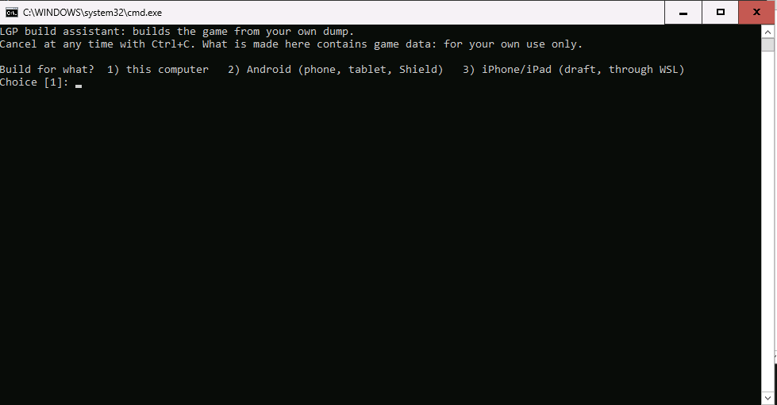
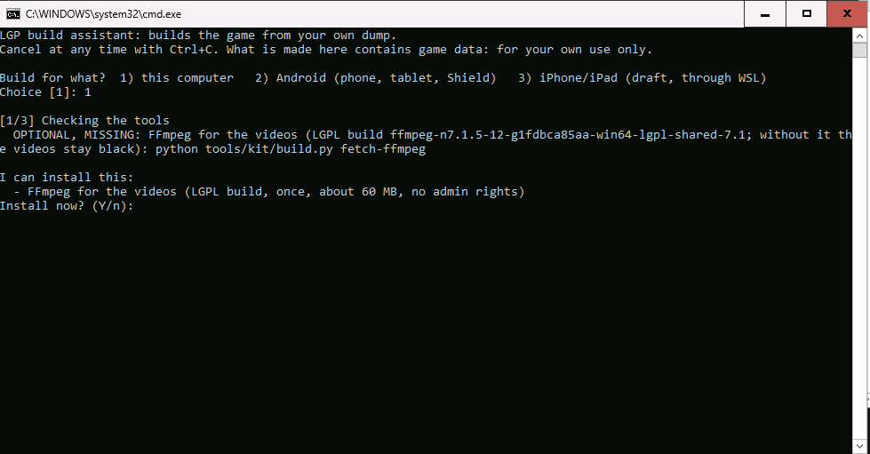
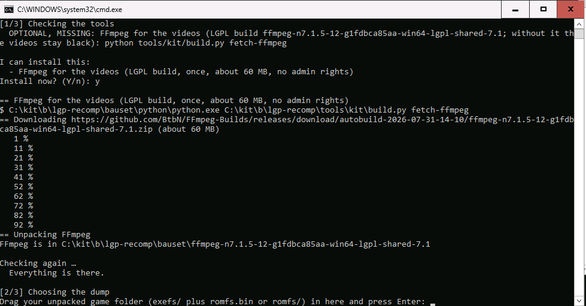
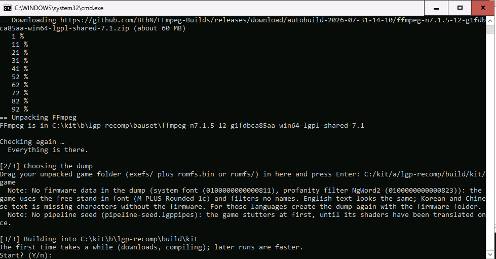
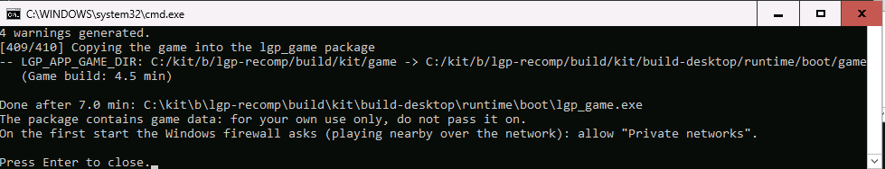

# Building LGP yourself: a guide for friends

You build "Pokémon: Let's Go, Pikachu!" from **your own** dump for your computer, your Android device or your
iPhone/iPad. What comes out contains game data from your dump: for your own use only, never pass it on. Nobody here
hands out finished builds, not even whoever gave you the tool.

## What you need

| What | Where from |
|---|---|
| Game folder of Let's Go Pikachu or Eevee, version **1.0.0** or **1.0.2**: `exefs/` plus `romfs.bin` or `romfs/` | unpacked yourself from your own Switch (this tool decrypts nothing) |
| `game.cfg` and `mods/` | come with the package (folder `kit-files/`); with the bare source code, unpack the mods' release package into `kit-files/` |
| About 10 GB free space next to the game folder (build 6 GB, tools 0.5 GB); 5 to 13 minutes on a strong PC | |

The assistant compiles as many parts at once as free memory and processor cores allow (about 1 GB per part; the
largest step was measured at 0.7 GB). With little memory it takes longer but does not stop. By hand:
`build.py build … --jobs 2`.

## Windows

Checked on 2026-11-03 in a freshly set-up Windows virtual machine (4 cores, 8 GB) that had nothing installed: about
7 minutes for the build, at most 3.6 GB of memory. The pictures are from that run.

1. Download the ready-made package `lgp-bauset-windows-x64-….zip` from the releases and unpack it into a short path
   without special characters, for example `C:\kit`. Put your game folder (`exefs/` plus `romfs.bin` or `romfs/`)
   somewhere outside that folder.
2. Double-click `lgp-recomp\lgp-bauen.cmd`. Choice `1` (this computer), Enter.

   
3. The assistant checks its tools. It offers FFmpeg for the videos (about 60 MB, once, no admin rights): `y`.

   
4. Drag your game folder into the window and press Enter (typing the path works too).

   
5. Notes about missing firmware data or a missing pipeline seed are normal: the game then uses a free stand-in font
   and stutters for a while at first. `game.cfg` and the mods come from the package (folder `lgp-recomp\kit-files`).
   Confirm "Start?" with `y`.

   
6. At the end the assistant names `lgp_game.exe` and opens its folder. Many compiler warnings before that are normal.

   

Start the game with `lgp_game.exe`. On the first start the Windows firewall asks (for playing nearby over the
network): allow "Private networks". Without FFmpeg (declined, or the download failed) the videos stay black; later
`python tools\kit\build.py fetch-ffmpeg` and build again.

## macOS

Checked on 2026-11-03 on a Mac that already had Xcode and CMake (MacBook Pro M5 Pro, about 2.5 minutes) and in a
fresh macOS 15 virtual machine without any developer tools (about 3.5 minutes, at most 2.3 GB of memory); both times
the app reached the title video. Plan about 25 GB of free space on a Mac without developer tools: the Command Line
Tools take several GB themselves, and the virtual machine's 41 GB disk was tight.

1. Download `lgp-build-kit-….zip` from the releases (source code with `kit-files/`) and unpack it (double-click in
   Finder).
2. Double-click `lgp-bauen.command` in the unpacked folder. The first time macOS refuses a file from the internet
   ("cannot be opened" or "Apple could not check it"): right-click (or Ctrl-click) the file → Open, then Open again
   in the dialog. On macOS 15 you may instead have to go to System Settings → Privacy & Security and click "Open
   Anyway" near the bottom. A Terminal window opens with the assistant.
3. Without Apple's developer tools (Command Line Tools) the window says so and Apple's install dialog opens: click
   "Install", accept the licence, wait until it says the software was installed (a few minutes), then press
   Enter in the window. Pressing Enter too early only asks again.
4. If CMake or Ninja are missing, the assistant lists them and offers to install them with pip into your user folder
   (no admin rights, no password); answer `y`.
5. Choice `1` (this Mac; on a Mac `2` is iPhone/iPad and `3` Android). Drag the game folder into the window and press
   Enter; the summary follows. Confirm "Start?" with `y`.
6. After a few minutes the window says the build is done and the folder with `lgp_game.app` opens (about 2 GB, it
   holds your game data). Warnings from the compiler on the way are normal.

Start the game with a double-click on `lgp_game.app`. If the work folder is on an external drive, the first start
can wait several minutes until you allow macOS access to that drive (a system dialog, sometimes behind the window).
Allow it once; later starts are quick. The window at the end also lists what the build left outside the folder
(the tool cache, the work folder with game data), so you can delete it later.

## Android (phone, tablet, Shield)

1. Start the assistant (Windows or Mac as above), choice `2`.
2. The first time it downloads the Android SDK (about 2.7 GB) and a Java (Microsoft's JDK 21, about 200 MB) as
   folders, without installing anything.
3. On the device: switch on the developer options and USB debugging, connect by USB, allow the request on the device.
4. After the build the assistant asks "Install on the device now?" → `y`.
   Later, without building again: `python3 tools/kit/build.py install --target android`.

Saves survive updates as long as you always build on the same computer (the signing key lives there). With another
key only uninstalling helps, and that deletes the saves.

## iPhone/iPad

**Important first:**
- You sign yourself with your Apple ID. With a **free** Apple ID the app runs for **7 days**; then install it once
  more (the saves stay). At most 3 such apps at a time.
- Apple does not give free Apple IDs all the memory the game would like. **Provisionally shown** (iPad,
  2026-10-26): with a free Apple ID the game starts up to the title screen (30 fps, at most 1.7 GB of memory) and
  with a save loads the field; walking works (about 30 fps, peak 2.5 GB, no crash). This is shown only by the log,
  not looked at on screen; not tested on an iPhone at all yet. If it turns out not to be enough, iPhone/iPad only
  works with a paid Apple developer account (99 €/year).
- On the first start: Settings → General → VPN & Device Management → trust your Apple ID. After deleting the app,
  iPadOS asks for this again.
- No iCloud saves (they do not work with a free Apple ID); back up your saves yourself.

**With a Mac (recommended):**
1. Xcode from the App Store, open it once, add your Apple ID under Xcode → Settings → Accounts.
2. Start the assistant, choice `2`. It reads the Apple team from Xcode; with a free Apple ID it builds without
   iCloud saves. It also offers an `.ipa` for a sideloader instead (Impactor, SideStore, AltStore); to skip that
   question (and the choice of device), start it in Terminal as `./lgp-bauen.command --installer sideload`.
3. Connect the iPhone/iPad by USB, unlock it, tap "Trust"; after the build "install?" → `y`.

**Without a Mac, on Windows (draft, not tried yet):**
1. Download Xcode **yourself** (`Xcode.xip`, https://developer.apple.com/download/all/, with your Apple ID).
   To be honest: Apple's licence allows Xcode only on Apple devices; never pass on the SDK from it.
2. Start the assistant, choice `3`. If WSL (Linux in Windows) is missing, it offers to install it (needs a restart).
3. In WSL it offers the packages it needs; you set up the SDK with `xtool sdk install <Xcode.xip>`
   (xtool: https://xtool.sh, guide "Installation (Linux/Windows)"; no sign-in needed for this).
4. After the build you get `lgp_game.ipa`. Install it with a sideloader and sign in there with your Apple ID:
   Impactor (Windows, macOS, Linux, https://github.com/claration/impactor/releases), SideStore or AltStore.
   **Not Sideloadly**: it drops the memory entitlement `increased-memory-limit`, and the game is then closed for lack
   of memory. Impactor kept it in our iPad test (2026-10-28, free Apple ID); SideStore and AltStore are not checked.
   **Warning:** If your Apple ID already has too many certificates, Impactor asks to "reset your certificate". Saying
   yes revokes an old certificate, and apps signed with it (for example from SideStore, AltStore, xtool or Xcode with
   the same Apple ID) stop working. Back up their saves first, or say no.
5. After the first start, `Documents/logs/lgp.log` (Files app) has a line
   `code signature: increased-memory-limit signed yes, profile yes` when the sideloader kept it.
   The old way with `xtool install` (Apple ID login in xtool, USB through usbipd) stays available with
   `--installer xtool`. Install the newest xtool: Apple changes its sign-in now and then (last on 22.10.2026); on
   error -80046 update xtool and sign in again.

## Cleaning up

With the ready-made package on Windows everything stays in the unpacked folder (tools in `bauset\`, the build in
`build\kit\`): delete the folder and the tool is gone. Nothing is installed. At the end the assistant names what lies
outside the folder. For the Android build that is the signing key in `%LOCALAPPDATA%\lgp-recomp\android`. Please keep
it: with a new key Android only allows uninstalling, and that deletes the saves.
Without the ready-made package, on a Mac and for iPhone/iPad through WSL, tools get installed (Xcode, WSL, packages);
the assistant names each before it installs anything.

## Keyboard

On a computer without a controller the keyboard plays (the keys are named as on a US layout, so on a German QWERTZ
keyboard A is the `Y` key):

| Switch | Key |
|---|---|
| A / B / X / Y | `Z` (QWERTZ `Y`) / `X` / `C` / `V` |
| Left stick / right stick | `W` `A` `S` `D` / `I` `J` `K` `L` |
| D-pad | arrow keys |
| L / R / ZL / ZR | `E` / `U` / `Q` / `O` |
| Minus / Plus | `-` / `=` or Enter (or the keypad) |
| Throw | Space |
| Full screen | F11 |

## When something goes wrong

- On every error the assistant writes what is missing and how to go on; after fixing it just start again, it skips
  the steps that are done.
- "The dump is not one of the supported game versions": the kit knows both editions in versions 1.0.0 and 1.0.2
  only.
- On a Mac the build log shows `ERRORRuntime cpu capability detection needed for MAY_HAVE_NEON` (twice): a
  message of the audio library Opus, not an error; the build goes on.
- "Note: the mod … does not fit this game build": that mod file was made for another version of the kit (e.g. a
  newer widescreen file). The build goes on without it, the file is kept in `game/mods-left-out/`; take the mod files
  that belong to this kit.
- "No pipeline seed": the game builds its shaders the first time it meets them, so it stutters for a while at first.
  That is expected; a seed is made from game data and is therefore not part of the kit.
- Many compiler warnings for `lifted*.cpp`, and a Python traceback from `mbedtls` `config.py` while configuring: both
  are harmless as long as the build goes on to "Done after …".
- Windows says `opengl32.dll` is missing when the game starts: normal Windows 10/11 has it; some Windows Server
  installations (found on Server 2025 in a VM) do not. Play on a normal Windows installation.
- Questions to Paul, with the assistant's last screen (without paths that show your name, if you prefer).
